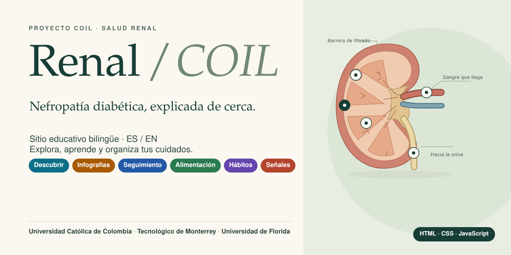

<p align="center"></p>

# Renal / COIL

Sitio web educativo y bilingüe (español / inglés) sobre **nefropatía diabética**, desarrollado como proyecto COIL entre la Universidad Católica de Colombia, el Tecnológico de Monterrey y la Universidad de Florida.

> **Aviso:** el contenido es educativo. No reemplaza una consulta médica ni calcula diagnósticos. Algunos datos (base de alimentos, estadísticas, glosario) son **de ejemplo y están pendientes de validación** por un profesional.

## Qué incluye

| Sección | Para qué sirve |
| --- | --- |
| Descubrir | Anatomía del riñón explicada de forma interactiva |
| Infografías | Causa, consecuencia y tratamiento; síntomas y términos clave |
| Seguimiento | Registro de mediciones con gráficas, CSV e informe imprimible |
| Alimentación | Recetas y diario de comidas con comparación contra metas propias |
| Hábitos | Semana y mes, rachas y notas |
| Señales | Orientación sobre síntomas y preguntas para la consulta |
| Proyecto | Equipo, fuentes y presentación |

Los datos del usuario se guardan **solo en su navegador** (sin servidor ni cuentas). Ver `PRIVACIDAD.md`.

## Cómo verlo

Es HTML, CSS y JavaScript sin frameworks. Necesitas un servidor local, no basta con abrir `index.html`:

```
python servidor.py
```

y entra a `http://localhost:8000`. También sirve la extensión Live Server de VS Code, o abrir `Abrir_sin_instalar.html` con doble clic (versión autónoma).

Pruebas (opcional, requiere Node.js):

```
npm install
npm test
```

## Estructura

```
index.html        página principal
css/              estilos
js/               lógica por sección
data/             textos ES/EN, recetas, alimentos, rangos
assets/           imágenes, ilustraciones y fuentes
tests/            pruebas automáticas
tools/            utilidades (versión portable, verificación)
docs/             guías, validación y próximos pasos
```

La guía completa de edición está en [`LEEME.md`](LEEME.md) y los pendientes en [`docs/PROXIMOS_PASOS.md`](docs/PROXIMOS_PASOS.md).

## Alcance y decisiones del equipo

**Ya funciona (sin servidor):**
- **Registros independientes por persona:** el sitio permite crear hasta 30 **perfiles** en un mismo navegador. Cada uno tiene sus propias mediciones, hábitos, favoritas y comidas, separados de los demás. Un perfil se puede exportar e importar como archivo JSON.
- **Diario de comidas:** crear, ver, editar y borrar comidas, comparar con una base de alimentos de ejemplo y compartir un platillo como texto o archivo.

**Decisión del equipo: sin historial centralizado de personas.** Se descartó, por ahora, llevar en un servidor el historial de las personas que consumen los platillos. Razones:
- Implica guardar **datos de salud de terceros**, con obligaciones de privacidad (Ley 1581 de 2012 en Colombia, LFPDPPP en México).
- Necesita un responsable que mantenga el servicio, y esa persona todavía no está definida. El proyecto se monta este semestre y hay que resolver quién le da seguimiento después.
- Hoy los perfiles se guardan **sin cifrar, solo en el navegador** y no son cuentas privadas. El sitio lo avisa al usuario.

**Pendiente para una etapa posterior:** autenticación y red social para compartir platillos. Las opciones evaluadas (Supabase o Firebase), la moderación y los requisitos legales están en [`docs/PROXIMOS_PASOS.md`](docs/PROXIMOS_PASOS.md).

## Equipo

**Universidad Católica de Colombia**

| Persona | Aporte |
| --- | --- |
| Mathew Pereira Uribe | Versión base del sitio y estructura del repositorio |
| Gabriel Betancourt | Complementa el proyecto _(área por definir)_ |
| Laura | Complementa el proyecto _(área por definir)_ |

**Próximamente:** se sumarán al equipo integrantes del **Tecnológico de Monterrey** (México) y de la **Universidad de Florida** (Estados Unidos), socios del proyecto COIL. Sus nombres y áreas se agregarán aquí cuando se unan al repositorio.

Cómo colaborar: lee [`CONTRIBUTING.md`](CONTRIBUTING.md).

## Historial

Las primeras entradas del historial corresponden a la **importación inicial** de la versión 3.5, subida por partes. El trabajo del equipo continúa en commits, ramas y pull requests propios.
